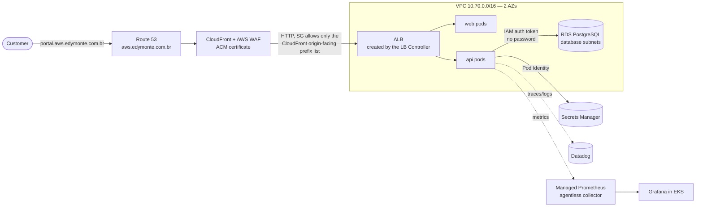
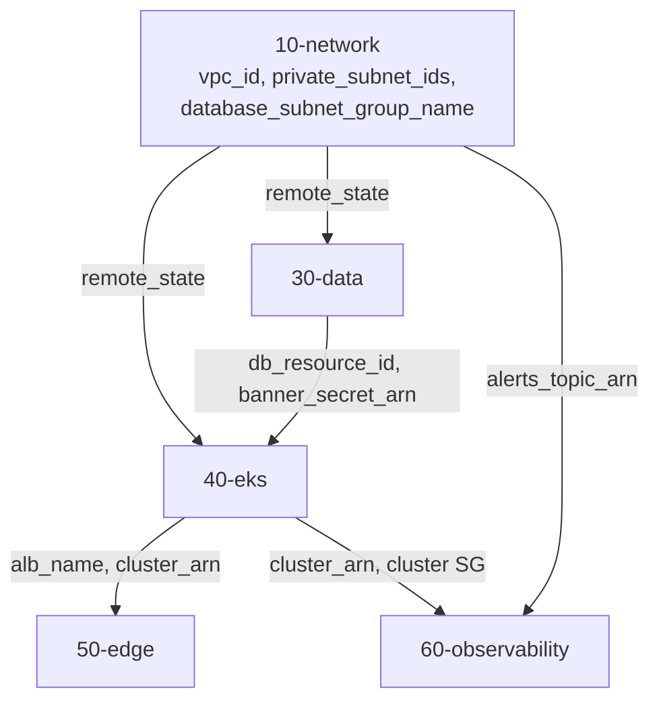
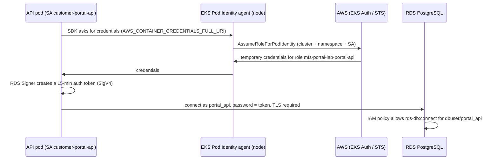

# How this environment works

> Read this **before** your first `terraform apply`. It explains what gets built, why it is split the way it is, and how the pieces talk to each other. The labs (`docs/labs/`) are the *how-to*; this is the *how it works*. If you already did the Azure version, read [AZURE-AWS-MAPPING.md](AZURE-AWS-MAPPING.md) first.

---

## 1. The story

**Monteiro Financial Services (MFS)** is expanding its **Customer Portal** to AWS. You are the platform engineer. Same production requirements as on Azure:

| # | Business requirement | How the platform meets it |
|---|---|---|
| 1 | Own domain, HTTPS, protection against web attacks | Route 53 + ACM + CloudFront + AWS WAF (`50-edge`) |
| 2 | No database or secret exposed to the internet | Private DB subnets + Secrets Manager + EKS Pod Identity + RDS IAM auth (`30-data`, `40-eks`) |
| 3 | No manual access to the cluster to deploy | GitOps with Argo CD + pipelines that only open PRs |
| 4 | Auditable compliance | AWS Config (managed + custom Guard rules), GuardDuty, Security Hub (`20-governance`) |
| 5 | Operations finds problems before customers do | Amazon Managed Prometheus + Grafana + CloudWatch Container Insights + Datadog |
| 6 | A tested contingency plan | Route 53 failover DR lab + game days |
| 7 | Delivery through GitHub **and** Azure DevOps | Equivalent pipelines, both with OIDC to AWS |

Everything is created with **Terraform**. The only imperative steps are:

1. installing Argo CD once (`bootstrap-gitops.ps1`);
2. creating the IAM-authenticated database user (`db-grant-app-user.ps1`) — SQL DDL is not an AWS resource;
3. writing secret **values** (`aws secretsmanager put-secret-value`) — **a secret never enters Terraform state**.

---

## 2. The big picture



**CloudFront is the only way in.** The ALB's security group only allows the AWS-managed prefix list `com.amazonaws.global.cloudfront.origin-facing`. The API reaches RDS with a **15-minute IAM token** signed by its pod's role — no password anywhere.

---

## 3. Layers — one state per layer

```text
infra/terraform/
├── 00-bootstrap      LOCAL state   → S3 state bucket, Route 53 zone, budget, name_suffix   (whole lab)
├── 05-identity       remote state  → OIDC providers, pipeline roles, permissions boundary  (whole lab)
├── 10-network        remote state  → VPC (2 AZs), NAT, S3 endpoint, flow logs, SNS alerts  ┐
├── 20-governance     remote state  → Config rules, GuardDuty, Security Hub, account guards │
├── 30-data           remote state  → RDS PostgreSQL (IAM auth), Secrets Manager            │ up/down
├── 40-eks            remote state  → EKS, node group, Pod Identity roles, ECR, ALB SG      │ daily
├── 50-edge           remote state  → ACM, CloudFront, WAF, Route 53 records, DR failover   │
├── 60-observability  remote state  → AMP workspace, managed collector, alert rules         │
└── 70-datadog        remote state  → Datadog monitors, SLO, dashboard                      ┘
```

Same reasoning as the Azure project (blast radius, cost control, ownership, explicit order). Two AWS-specific details:

**State locking without DynamoDB.** Since Terraform 1.10 the S3 backend can lock with a lock **file** next to the state (`use_lockfile = true`). The classic DynamoDB lock table is no longer required — a common interview question.

```hcl
# .runtime/backend.hcl (generated by awp.ps1 bootstrap)
bucket       = "mfs-tfstate-<account>-<suffix>"
region       = "us-east-1"
encrypt      = true
use_lockfile = true
```

**Layers talk through `terraform_remote_state`:**



---

## 4. Anatomy of a layer

| File | Purpose |
|---|---|
| `versions.tf` | Terraform and provider versions (`aws ~> 6.0`) |
| `backend.tf` | `backend "s3" {}` — empty on purpose, completed at `init` |
| `providers.tf` | Region + `default_tags` (every resource gets Owner/Environment/CostCenter/Layer automatically) |
| `common-variables.tf` | region, org, environment, name_suffix, tags |
| `remote-state.tf` | Reads outputs of earlier layers |
| `main.tf` | Resources and community modules, with *why* comments |
| `variables.tf` / `outputs.tf` | Inputs with validation / the published contract |

> 💡 `default_tags` in the provider is the AWS-side answer to "how do you enforce tagging?". It is **preventive at the source**; the Config rule `required-tags` is **detective**; an SCP or tag policy (AWS Organizations) would be **preventive at the account boundary**.

---

## 5. Modules: raw resources vs community modules

The Azure project uses raw resources everywhere. Here, the two most complex pieces use the **community modules** that most AWS consulting teams use:

| Module | Why a module here |
|---|---|
| `terraform-aws-modules/vpc/aws` | Subnets, route tables, NAT, IGW, DB subnet group, flow logs: ~40 resources with well-known defaults |
| `terraform-aws-modules/eks/aws` (v21) | Cluster, node group launch template, IAM roles, security groups, add-ons, access entries |

Everything else is raw resources so you see the building blocks. **Interview angle:** "modules buy speed and battle-tested defaults; you pay with version upgrades (EKS module v20 → v21 renamed many inputs) and less visibility — so pin versions and read the module's changelog."

---

## 6. Layer by layer

| Layer | Creates | Terraform technique | AWS concept (SAA-C03 domain) |
|---|---|---|---|
| `00-bootstrap` | S3 state bucket, Route 53 zone, Budget | local state, `dynamic` blocks, bucket hardening resources | S3 security, Budgets (D4 cost) |
| `05-identity` | OIDC providers, plan/deploy roles, boundary | `for_each` over a map of trust policies, `aws_iam_policy_document` | IAM roles, federation, permissions boundaries (D1 security) |
| `10-network` | VPC, subnets, NAT, endpoints, flow logs, SNS | community module, `cidrsubnet`, conditional `for_each` | VPC design, NAT, gateway vs interface endpoints (D1/D2) |
| `20-governance` | Config rules (managed + Guard), GuardDuty, Security Hub, account guards | `for_each` over a rules map, `file()` for Guard policy | Detective vs preventive controls (D1) |
| `30-data` | RDS PostgreSQL, SGs, Secrets Manager | remote state, `manage_master_user_password` | RDS, IAM DB auth, Secrets Manager (D1/D2) |
| `40-eks` | EKS, node group, Pod Identity roles, ECR, ALB SG | module v21, `file()` for upstream IAM policy, prefix lists | EKS, ECR, ALB, security groups (D2/D3) |
| `50-edge` | ACM, CloudFront, WAF, alias records, DR failover | two providers (`aws.dr`), `dynamic` override actions | CloudFront, WAF, Route 53 routing policies (D2/D3) |
| `60-observability` | AMP workspace, managed collector, rules, Alertmanager→SNS | heredoc YAML, access entry for a service role | Managed Prometheus, SNS (D2) |
| `70-datadog` | Monitors, SLO, dashboard | another provider, `templatefile()` | Monitoring as code |

---

## 7. The four flows

### 7.1 Request flow

```text
Browser
  → Route 53: portal.aws.edymonte.com.br  A (alias) → dxxxx.cloudfront.net          (50-edge)
  → CloudFront: TLS with ACM cert; AWS WAF evaluates; Host header forwarded (AllViewer)
  → origin: alb-mfs-portal-lab-xxxx.us-east-1.elb.amazonaws.com:80                   (LB Controller)
  → ALB security group: only CloudFront origin-facing prefix list on :80             (40-eks)
  → ALB rule by host + path → target group of POD IPs (target-type ip)               (gitops Ingress)
  → NetworkPolicy (VPC CNI): pods accept only VPC CIDR (ALB, collector)              (gitops chart)
  → API → RDS: private DB subnet, SG allows 5432 from private subnets only           (30-data)
```

### 7.2 Identity flow (Pod Identity + RDS IAM auth)



**Pod Identity vs IRSA (interview classic):** IRSA uses the cluster's OIDC provider + an annotation on the ServiceAccount and a trust policy per cluster. Pod Identity uses an agent and an **association** (cluster, namespace, SA → role); the role trusts one service principal (`pods.eks.amazonaws.com`) and can be reused across clusters without editing trust policies.

Pipelines use the same principle with **OIDC → `sts:AssumeRoleWithWebIdentity`**: GitHub's token subject must match the role's trust condition (`repo:edymonte/aws-enterprise-platform:environment:lab`).

### 7.3 Delivery flow (GitOps)

Identical to the Azure project: CI builds, scans, pushes to **ECR (immutable tags)** and opens a PR bumping `gitops/envs/dev/values.yaml`; Argo CD syncs; promotion to prod is another PR; rollback is `git revert`.

### 7.4 Observability flow

| Signal | AWS-native | Datadog |
|---|---|---|
| App metrics | pod annotations → **AMP managed collector** (agentless) → AMP → Grafana | APM trace metrics |
| Container/node metrics + logs | CloudWatch **Container Insights** add-on | Datadog Agent |
| Alerts | AMP rule groups → **Alertmanager → SNS** → e-mail | Monitors (Terraform) |
| Dashboards | Grafana, JSON pulled from Git | `datadog_dashboard_json` |

---

## 8. Where are the secrets?

| Item | Where | How it reaches the consumer |
|---|---|---|
| Pipeline access to AWS | No secret: OIDC | IAM OIDC provider + role trust (`05-identity`) |
| API access to RDS | No secret: IAM DB auth | Pod Identity role with `rds-db:connect` |
| RDS master password | Secrets Manager (managed by RDS) | Used only by `db-grant-app-user.ps1`, via a temporary K8s Secret |
| Banner (sample secret) | Secrets Manager | Secrets Store CSI driver + AWS provider (Pod Identity), file mount |
| Datadog API key | Secrets Manager | `datadog-secret.ps1` → Secret in `datadog` |
| Terraform state | S3, versioned, encrypted, TLS-only policy | — |

---

## 9. Daily cycle and cost

```powershell
./scripts/awp.ps1 up -Through 40-eks     # ~20 min (EKS control plane ~10 min)
./scripts/bootstrap-gitops.ps1
./scripts/awp.ps1 down
```

Kept overnight: `00-bootstrap` (bucket, hosted zone $0.50/month, budget) and `05-identity` (free). The **NAT gateway** and the **EKS control plane** are the hourly costs to watch — see [costs.md](costs.md).
